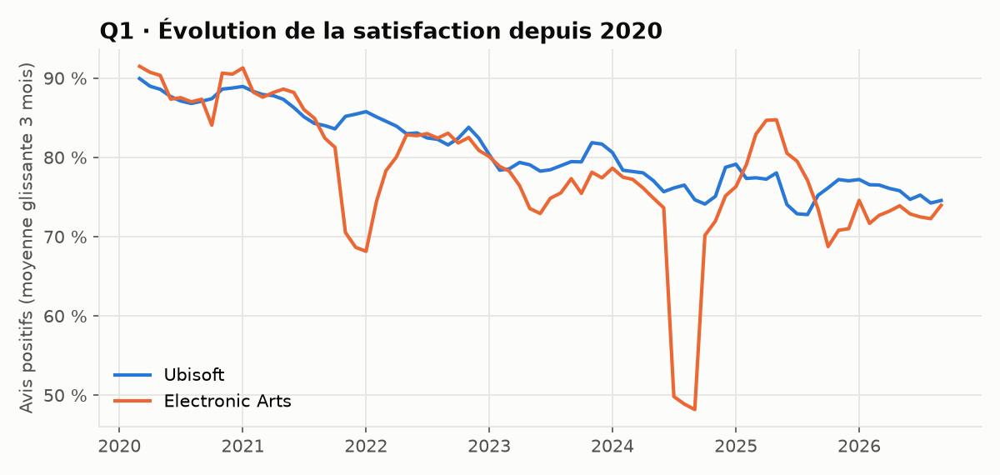
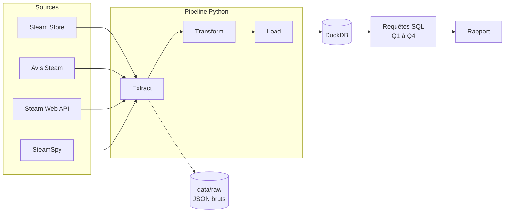

# 🎮 Ubisoft vs Electronic Arts : ce que révèlent les données Steam

🇬🇧 [English version](README.md) · 🇫🇷 **Français**


> **Pipeline ETL** qui collecte les données publiques Steam des jeux Ubisoft et Electronic Arts, les structure
> dans une base analytique et répond à quatre questions business pour un studio qui prépare son lancement.

> 🎭 **Scénario fictif, données réelles.** Le client *Lumen Forge Games* est inventé pour simuler une mission
> professionnelle complète, du brief à la recette. Les données Steam analysées sont réelles.
> Ce projet n'est ni affilié à Ubisoft, ni à Electronic Arts, ni à Valve.

---

## 📋 Sommaire

- [Le contexte client](#-le-contexte-client)
- [Les questions business](#-les-questions-business)
- [Résultats clés](#-résultats-clés)
- [Architecture](#-architecture)
- [Stack technique](#-stack-technique)
- [Démarrage rapide](#-démarrage-rapide)
- [Structure du projet](#-structure-du-projet)
- [Données personnelles (RGPD)](#-données-personnelles-rgpd)
- [Limites](#-limites)
- [Documentation de la mission](#-documentation-de-la-mission)

---

## 💼 Le contexte client

**Lumen Forge Games**, studio indépendant lyonnais, sortira son premier jeu sur Steam à environ 25 €.
Sans équipe data, il veut s'appuyer sur les données publiques des grands éditeurs pour décider
de **son prix de lancement**, de **sa politique de promotions** et de **son suivi de réputation** après la sortie.

## ❓ Les questions business

| # | Question | Décision éclairée |
|---|---|---|
| **Q1** | Lequel des deux éditeurs satisfait le mieux ses joueurs sur Steam, et cette satisfaction est-elle stable dans le temps ? | Suivi de réputation |
| **Q2** | Un jeu plus cher est-il mieux noté ? Les promotions sont-elles un signe de difficulté ? | Prix et promotions |
| **Q3** | Quels jeux gardent leurs joueurs des années après leur sortie ? | Contenu après le lancement |
| **Q4** | Les joueurs francophones jugent-ils différemment ces éditeurs ? | Marché prioritaire |

## 📊 Résultats clés

> **100 jeux** (50 par éditeur) · **9,8 millions d'avis** Steam · données du 2026-10-21.
> Rapport complet : [**PDF en français**](docs/livraison/Rapport_Ubisoft_vs_EA_FR.pdf) · [PDF in English](docs/livraison/Report_Ubisoft_vs_EA_EN.pdf).

| # | Constat |
|---|---|
| **Q1** | **Satisfaction moyenne identique (80 %), mais deux profils opposés.** EA est « quitte ou double » (médiane de 85 %, mais 11 jeux sous 70 %). Ubisoft est plus régulier, et ses jeux **gagnent +3,2 points après leur sortie** (12 jeux redressés de plus de 10 points). |
| **Q2** | **Plus un jeu est cher, moins il est bien noté** (corrélation de -0,5). Les jeux à 60 € et plus tombent à une médiane de 63 à 73 %. Les promotions ne sont pas mesurables : aucun jeu n'était en promotion le jour de l'extraction. |
| **Q3** | **Les jeux durables sont gratuits ou multijoueurs.** Les 4 jeux de 5 ans et plus les plus joués aujourd'hui sont des *free-to-play*. |
| **Q4** | **Les francophones sont légèrement plus généreux** (+2 points), mais ils ne rédigent que 2 % des avis. |

Le pipeline a aussi permis de **détecter deux crises de réputation** dans l'historique mensuel des avis :
le lancement de *Battlefield 2042* (novembre 2021) et un *review bombing* d'*Apex Legends* (82 120 avis négatifs en juillet 2024).



## 🏗️ Architecture



Le pipeline suit les trois étapes classiques :
1. **Extract** : interroge les API et conserve les réponses brutes, sans modification.
2. **Transform** : filtre le périmètre, nettoie, type les données et supprime toute donnée personnelle.
3. **Load** : charge les tables propres dans DuckDB, en remplaçant les données précédentes pour éviter les doublons.

## 🧰 Stack technique

| Technologie | Rôle | Pourquoi ce choix |
|---|---|---|
| **Python 3.14** | Langage du pipeline | Standard du data engineering |
| **requests** | Appels HTTP aux API | Simple, fiable, universel |
| **pandas** | Transformation | Adapté à des volumes modestes |
| **DuckDB** | Base analytique | Une base SQL dans un fichier, sans serveur |
| **SQL** | Analyse | Lisible, vérifiable, universel |
| **matplotlib** | Graphiques | Figures statiques pour le rapport |

Les choix techniques sont justifiés dans les [décisions d'architecture](docs/decisions/).

## 🚀 Démarrage rapide

**Prérequis :** Python 3.12 ou plus récent, et Git.

```bash
# 1. Cloner le dépôt
git clone https://github.com/MediJr/ubisoft-vs-ea-steam-etl.git
cd ubisoft-vs-ea-steam-etl

# 2. Créer et activer un environnement virtuel
python -m venv .venv
.venv\Scripts\activate        # Windows
# source .venv/bin/activate   # macOS / Linux

# 3. Installer les dépendances
pip install -r requirements.txt

# 4. Lancer le pipeline (environ 30 minutes : l'extraction respecte les limites de Steam)
python -m src.pipeline

# Variante : rejouer un lot brut déjà extrait, sans appeler les API (quelques secondes)
python -m src.pipeline --run-date 2026-10-21
```

**Résultat :** la base `data/steam.duckdb`, les graphiques `docs/livraison/figures/` et les résultats
`docs/livraison/resultats.md`. Pour explorer la base : `python -c "import duckdb; duckdb.connect('data/steam.duckdb').sql('SHOW TABLES').show()"`.

## 📁 Structure du projet

```text
ubisoft-vs-ea-steam-etl/
├── README.md
├── requirements.txt          ← dépendances Python
├── src/                      ← code du pipeline
│   ├── config.py             ← paramètres (périmètre, chemins, pauses)
│   ├── extract.py            ← collecte des données brutes
│   ├── transform.py          ← nettoyage et modélisation
│   ├── load.py               ← chargement dans DuckDB (transaction)
│   ├── report.py             ← graphiques et résultats des requêtes
│   └── pipeline.py           ← point d'entrée : enchaîne E → T → L → rapport
├── sql/                      ← schéma, requêtes Q1 à Q4, contrôles de recette
├── data/                     ← données locales (exclues de Git)
└── docs/
    ├── mission/              ← brief, cadrage, cahier des charges
    ├── decisions/            ← décisions d'architecture (ADR)
    ├── journal/              ← journal de bord
    ├── livraison/            ← rapports PDF (FR / EN), résultats, graphiques, PV de recette
    ├── rapport/              ← sources LaTeX des rapports
    └── dictionnaire-de-donnees.md
```

## 🔒 Données personnelles (RGPD)

L'API des avis Steam renvoie des pseudos et des identifiants de joueurs. En application du **principe de minimisation**
(RGPD, article 5.1.c), **seules des synthèses agrégées sont conservées**. Aucune donnée personnelle n'est stockée.

## ⚠️ Limites

- **Steam n'est pas tout le marché :** EA app, Ubisoft Connect et les consoles ne sont pas couverts.
- **Les ventes sont des estimations** (SteamSpy), pas des chiffres officiels.
- **Les prix sont un instantané :** Steam ne fournit pas d'historique des prix.
- **Certains points d'accès Steam ne sont pas officiels** et peuvent changer sans préavis.
- **L'ancienneté est celle sur Steam :** EA y est revenu en 2020 et Ubisoft fin 2022.
- **Instantané :** les prix et les joueurs connectés sont mesurés à un instant donné.

## 📚 Documentation de la mission

| Étape | Document |
|---|---|
| 1. Demande initiale | [Brief client](docs/mission/2026-10-21-01-brief-client.md) |
| 2. Cadrage | [Compte rendu de réunion](docs/mission/2026-10-21-02-compte-rendu-cadrage.md) |
| 3. Engagement | [Cahier des charges](docs/mission/2026-10-21-03-cahier-des-charges.md) |
| 4. Réalisation | [Journal de bord](docs/journal/) · [Décisions d'architecture](docs/decisions/) |
| 5. Livraison | [Rapport (PDF, FR)](docs/livraison/Rapport_Ubisoft_vs_EA_FR.pdf) · [Report (PDF, EN)](docs/livraison/Report_Ubisoft_vs_EA_EN.pdf) · [PV de recette](docs/livraison/2026-10-21-pv-recette.md) · [Dictionnaire de données](docs/dictionnaire-de-donnees.md) |

---

## 👤 Auteur

**Lumu Bamana Manasse**, data engineer en reconversion depuis la data analyse
(Google Data Analytics Professional Certificate, 2026).

Ce projet est le **niveau 0** d'un parcours de 7 projets, des fondamentaux jusqu'à une architecture cloud complète.

## 📄 Licence

Code sous licence [MIT](LICENSE). Les données Steam restent la propriété de leurs ayants droit
et sont utilisées à des fins d'analyse non commerciale.
