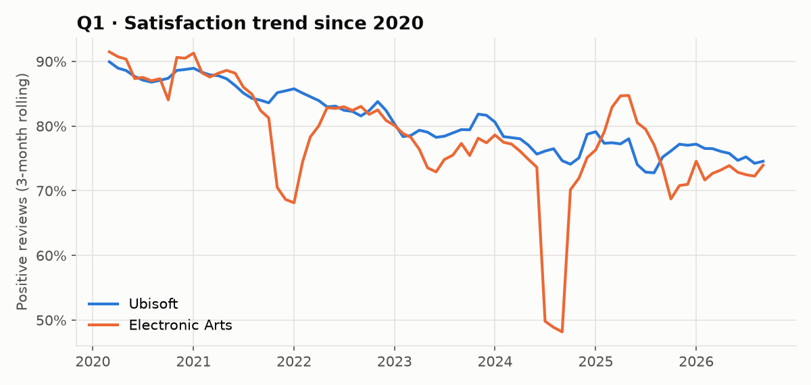
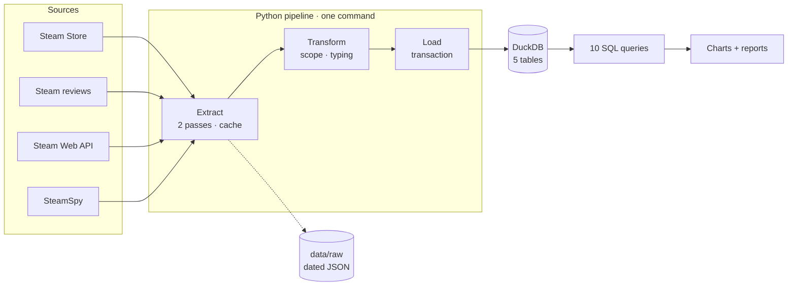

# 🎮 Ubisoft vs Electronic Arts: what Steam data reveals

🇬🇧 **English** · 🇫🇷 [Version française](README.fr.md)


> An **end-to-end ETL pipeline** that collects public Steam data on Ubisoft and Electronic Arts games, models it in an
> analytical database and answers four business questions for an indie studio preparing its launch.

> 🎭 **Fictional scenario, real data.** The client *Lumen Forge Games* is invented to simulate a complete professional
> engagement, from brief to acceptance testing. The Steam data analysed is real.
> This project is not affiliated with Ubisoft, Electronic Arts or Valve.

## 📄 Reports

| | |
|---|---|
| 🇬🇧 **Data engineering report (PDF, English)** | [Report_Ubisoft_vs_EA_EN.pdf](docs/livraison/Report_Ubisoft_vs_EA_EN.pdf) |
| 🇫🇷 **Rapport d'ingénierie des données (PDF, français)** | [Rapport_Ubisoft_vs_EA_FR.pdf](docs/livraison/Rapport_Ubisoft_vs_EA_FR.pdf) |

19 pages, written in LaTeX ([sources](docs/rapport/)): executive summary, scoping, data sources, architecture, pipeline design,
data model, data quality, GDPR, operations runbook, acceptance testing, results, limitations and roadmap.

---

## 💼 Business context

**Lumen Forge Games**, an indie studio based in Lyon, France, will release its first game on Steam at around €25.
With no data team, it wants to use public data from major publishers to decide on **its launch price**, **its discount policy**
and **how to monitor its reputation** after release.

| # | Business question | Decision supported |
|---|---|---|
| **Q1** | Which publisher best satisfies its players on Steam, and is that satisfaction stable over time? | Reputation monitoring |
| **Q2** | Are more expensive games rated higher? Are discounts a sign of trouble? | Price and discounts |
| **Q3** | Which games keep their players years after release? | Post-launch content |
| **Q4** | Do French-speaking players judge these publishers differently? | Priority market |

## 📊 Key findings

> **100 games** (50 per publisher) · **9.8 million Steam reviews** · data extracted on 2026-10-21.

| # | Finding |
|---|---|
| **Q1** | **Same average satisfaction (80%), two opposite profiles.** EA is "hit or miss" (85% median, but 11 games below 70%). Ubisoft is more consistent, and its games **gain 3.2 points after release**. |
| **Q2** | **The more expensive the game, the lower its rating** (correlation ≈ −0.5). Games at €60+ drop to a 63–73% median. Discounts could not be measured: no game was on sale on extraction day. |
| **Q3** | **Long-lived games are free-to-play or multiplayer.** The 4 most-played games aged 5+ years are all free-to-play. |
| **Q4** | **French speakers are slightly more generous** (+2 points), but they write only 2% of reviews. |

The monthly review history also surfaced **two reputation crises**: the *Battlefield 2042* launch (November 2021) and a
*review bombing* of *Apex Legends* (82,120 negative reviews in July 2024).



## 🏗️ Architecture



## 🛠️ Data engineering highlights

| Practice | Implementation |
|---|---|
| **Immutable raw layer** | API responses stored as-is in `data/raw/<date>/`, with a manifest per batch. Any batch can be replayed without calling the APIs. |
| **API-friendly extraction** | Two-pass extraction (full details only for games with 500+ reviews), 1.5 s throttling, retries with back-off on 429/5xx, explicit User-Agent. |
| **Resilience** | Per-batch cache: an interrupted run resumes where it stopped (a real incident was recovered in 0.1 s). Atomic writes. |
| **Idempotency** | Primary keys on every table, full refresh inside a single transaction: re-running never creates duplicates. |
| **Privacy by design** | Reviews requested with `num_per_page=0`: no username or player ID is ever downloaded (GDPR data minimisation). |
| **Data quality** | 4 real-world issues found and fixed (unaccented French month names, SteamSpy zeros meaning "unknown", untracked exclusions, biased launch window). |
| **Traceability** | Exclusions table with reasons, 3 Architecture Decision Records, dated work log, CHANGELOG. |
| **Acceptance testing** | 6/6 criteria met on a fresh clone and virtual environment. |

## 🧰 Tech stack

| Technology | Role | Why |
|---|---|---|
| **Python 3.14** | Pipeline language | Data engineering standard |
| **requests** | HTTP calls | Simple and reliable |
| **pandas** | Transformation | Right-sized for a few thousand rows |
| **DuckDB** | Analytical database | Serverless SQL in a single file |
| **SQL** | Analysis | Readable, verifiable, portable |
| **matplotlib** | Charts (FR and EN) | Static figures for the reports |
| **LaTeX (XeLaTeX)** | Reports | Professional, versioned documents |

## 🚀 Quick start

**Requirements:** Python 3.12+ and Git.

```bash
git clone https://github.com/MediJr/ubisoft-vs-ea-steam-etl.git
cd ubisoft-vs-ea-steam-etl

python -m venv .venv
.venv\Scripts\activate          # Windows
# source .venv/bin/activate     # macOS / Linux

pip install -r requirements.txt

# Full run (~30 min: extraction respects Steam's rate limits)
python -m src.pipeline

# Replay an existing raw batch without calling the APIs (a few seconds)
python -m src.pipeline --run-date 2026-10-21
```

**Outputs:** the `data/steam.duckdb` database, charts in `docs/livraison/figures/{fr,en}/` and query results in
`docs/livraison/resultats.md`.

## 📁 Repository structure

```text
ubisoft-vs-ea-steam-etl/
├── src/
│   ├── config.py        ← scope and network settings
│   ├── extract.py       ← E: raw data collection (cache, retries, atomic writes)
│   ├── transform.py     ← T: scope rules, typing, exclusions
│   ├── load.py          ← L: transactional load into DuckDB
│   ├── report.py        ← charts (FR/EN) and query results
│   └── pipeline.py      ← entry point: E → T → L → report
├── sql/                 ← schema, Q1–Q4 queries, acceptance checks
├── docs/
│   ├── mission/         ← client brief, scoping minutes, statement of work (French)
│   ├── decisions/       ← Architecture Decision Records
│   ├── journal/         ← dated work log
│   ├── livraison/       ← PDF reports, results, charts, acceptance sign-off
│   ├── rapport/         ← LaTeX sources of the reports
│   └── dictionnaire-de-donnees.md
├── data/                ← raw batches and database (git-ignored, rebuilt by the pipeline)
├── CHANGELOG.md · LICENSE · requirements.txt
```

## ⚠️ Limitations

- **Steam only:** EA app, Ubisoft Connect and consoles are not covered.
- **Snapshot:** prices and player counts are measured at a single point in time.
- **List price, not launch price:** possible survivorship bias in Q2.
- **Years on Steam ≠ actual age:** EA returned to Steam in 2020 and Ubisoft in late 2022.
- **Some Steam endpoints are unofficial** and may change without notice.

## 📚 Engagement documents

| Step | Document |
|---|---|
| 1. Initial request | [Client brief](docs/mission/2026-10-21-01-brief-client.md) |
| 2. Scoping | [Meeting minutes](docs/mission/2026-10-21-02-compte-rendu-cadrage.md) |
| 3. Commitment | [Statement of work](docs/mission/2026-10-21-03-cahier-des-charges.md) |
| 4. Delivery | [Work log](docs/journal/) · [ADRs](docs/decisions/) · [Data dictionary](docs/dictionnaire-de-donnees.md) |
| 5. Acceptance | [Reports (PDF)](docs/livraison/) · [Acceptance sign-off](docs/livraison/2026-10-21-pv-recette.md) |

*Engagement documents are written in French, as for a French client.*

---

## 👤 Author

**Lumu Bamana Manasse**, data engineer transitioning from data analytics
(Google Data Analytics Professional Certificate, 2026) · GitHub: [@MediJr](https://github.com/MediJr)

This is **level 0** of a seven-project data engineering portfolio, from fundamentals to a full cloud architecture.

## 📄 License

Code released under the [MIT License](LICENSE). Steam data remains the property of its respective owners and is used
for non-commercial analysis.
