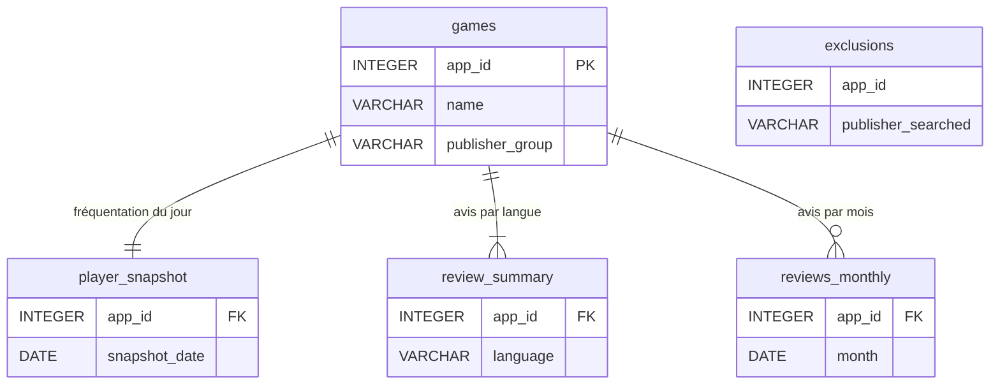

# Dictionnaire de données

> Base : `data/steam.duckdb` · Schéma : [`sql/00_schema.sql`](../sql/00_schema.sql) · Mise à jour : rechargement complet à chaque exécution

---

## `games` : un jeu retenu dans le périmètre

**Grain :** une ligne par jeu. **Clé :** `app_id`.

| Colonne | Type | Description | Source |
|---|---|---|---|
| `app_id` | INTEGER | Identifiant unique du jeu sur Steam | Steam Store |
| `name` | VARCHAR | Nom du jeu | Steam Store |
| `publisher_group` | VARCHAR | Éditeur analysé : `Ubisoft` ou `Electronic Arts` | Pipeline |
| `publishers` | VARCHAR | Éditeur(s) déclaré(s) sur Steam | Steam Store |
| `developers` | VARCHAR | Studio(s) de développement | Steam Store |
| `is_free` | BOOLEAN | Jeu gratuit (*free-to-play*) | Steam Store |
| `price_initial_eur` | DECIMAL | Prix catalogue actuel hors promotion, en euros. **Ce n'est pas le prix de lancement.** | Steam Store |
| `price_final_eur` | DECIMAL | Prix payé le jour de l'extraction | Steam Store |
| `discount_percent` | INTEGER | Remise en cours le jour de l'extraction (%) | Steam Store |
| `steam_release_date` | DATE | Date de sortie **sur Steam**, qui peut être postérieure à la sortie mondiale | Steam Store |
| `years_on_steam` | DECIMAL | Ancienneté sur Steam au jour de l'extraction (années) | Pipeline |
| `genres` | VARCHAR | Genres Steam, en français | Steam Store |
| `metacritic_score` | INTEGER | Note de la presse (Metacritic), si disponible | Steam Store |
| `owners_estimate_low` / `_high` | BIGINT | Fourchette estimée du nombre de possesseurs | SteamSpy |
| `extracted_on` | DATE | Date de l'extraction | Pipeline |

## `review_summary` : synthèse des avis par langue

**Grain :** une ligne par jeu et par langue. **Clé :** (`app_id`, `language`).

| Colonne | Type | Description |
|---|---|---|
| `language` | VARCHAR | `all` (toutes langues) ou `french` (avis rédigés en français) |
| `total_reviews` | INTEGER | Nombre total d'avis |
| `total_positive` / `total_negative` | INTEGER | Avis « recommandé » / « non recommandé » |
| `positive_rate` | DECIMAL | Part d'avis positifs (0 à 1). NULL s'il n'y a aucun avis |
| `review_score_desc` | VARCHAR | Libellé Steam (« Très positives », « Moyennes »…) |

## `reviews_monthly` : avis publiés chaque mois

**Grain :** une ligne par jeu et par mois. **Clé :** (`app_id`, `month`). Source : historique des avis Steam.

| Colonne | Type | Description |
|---|---|---|
| `month` | DATE | Premier jour du mois |
| `reviews_up` / `reviews_down` | INTEGER | Avis positifs / négatifs publiés ce mois-là |

## `player_snapshot` : fréquentation au jour de l'extraction

**Grain :** une ligne par jeu et par date. **Clé :** (`app_id`, `snapshot_date`).

| Colonne | Type | Description | Source |
|---|---|---|---|
| `current_players` | INTEGER | Joueurs connectés au moment de l'appel | Steam Web API |
| `peak_players_yesterday` | INTEGER | Pic de joueurs simultanés la veille. **Non utilisé dans les analyses** : il vaut 0 pour les jeux récents ([ADR 003](decisions/2026-10-21-003-source-frequentation.md)) | SteamSpy |

## `exclusions` : candidats écartés

**Grain :** une ligne par jeu candidat écarté. **Clé :** (`app_id`, `publisher_searched`).

| Colonne | Type | Description |
|---|---|---|
| `publisher_searched` | VARCHAR | Éditeur pour lequel le jeu est remonté dans la recherche |
| `reason` | VARCHAR | Motif d'exclusion (autre éditeur, pas encore sorti, etc.) |

> Les jeux candidats ayant **moins de 500 avis** sont écartés dès l'extraction ([ADR 002](decisions/2026-10-21-002-strategie-extraction.md)).
> Ils figurent dans le manifeste du lot brut, pas dans cette table.

---

## 🔒 Données personnelles

**Aucune colonne de cette base ne contient de donnée personnelle.** Pseudos, identifiants Steam et textes d'avis
ne sont jamais téléchargés (minimisation RGPD, voir le [cahier des charges](mission/2026-10-21-03-cahier-des-charges.md), section 8).
Le contrôle C5 de [`sql/controle_recette.sql`](../sql/controle_recette.sql) le vérifie automatiquement.
