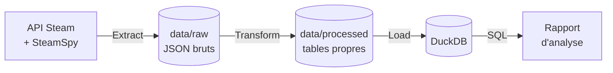

# 03 · Cahier des charges (Statement of Work)

> 🎭 **Scénario fictif** : voir le [brief client](2026-10-21-01-brief-client.md).

| | |
|---|---|
| **Référence** | LFG-2026-001 |
| **Version** | 1.0 |
| **Date** | 2026-10-21 |
| **Client** | Lumen Forge Games, représenté par Camille Roux |
| **Prestataire** | Data engineer indépendant |
| **Statut** | ✅ Validé par le client (voir section 11) |

---

## 1. Contexte

Lumen Forge Games, studio indépendant lyonnais, sortira son premier jeu d'action-aventure sur Steam l'an prochain,
à un prix envisagé de 25 €. Le studio ne dispose ni d'équipe ni d'outillage data.
Il souhaite s'appuyer sur les **données publiques de Steam** concernant deux grands éditeurs, Ubisoft et Electronic Arts,
pour éclairer ses décisions de lancement.

## 2. Objectifs

1. **Collecter** automatiquement les données publiques Steam des jeux de ces deux éditeurs.
2. **Structurer** ces données dans une base analytique réutilisable.
3. **Répondre** à quatre questions business, dans un rapport accessible à des non-spécialistes.

## 3. Questions business

| # | Question | Indicateurs prévus |
|---|---|---|
| **Q1** | Lequel des deux éditeurs satisfait le mieux ses joueurs sur Steam, et cette satisfaction est-elle stable dans le temps ? | Taux d'avis positifs global et pondéré, évolution mensuelle des avis depuis la sortie |
| **Q2** | Un jeu plus cher est-il mieux noté ? Les promotions sont-elles un signe de difficulté ? | Prix de lancement vs taux d'avis positifs, remise actuelle vs satisfaction |
| **Q3** | Quels jeux gardent leurs joueurs des années après leur sortie ? | Joueurs connectés et temps de jeu récent selon l'ancienneté du jeu |
| **Q4** | Les joueurs francophones jugent-ils différemment ces éditeurs ? | Taux d'avis positifs des avis en français vs toutes langues |

## 4. Périmètre

### ✅ Inclus

- Les jeux de type **« game »** publiés sur Steam par **Ubisoft** ou **Electronic Arts**
- Uniquement les jeux ayant **au moins 500 avis**, pour que les taux soient représentatifs
- Jusqu'à **50 jeux par éditeur**
- Les données publiques : fiche du jeu, synthèse des avis, historique mensuel des avis, joueurs connectés, estimations SteamSpy

### ❌ Exclus

- Les DLC, bandes-son, démos et éditions groupées (*bundles*)
- Les autres plateformes : EA app, Ubisoft Connect, consoles
- Le texte des avis et toute donnée personnelle de joueur
- L'impact des sorties sur le cours de bourse. C'est une **piste future** : il faudrait des données boursières et des méthodes statistiques dédiées.
- Un tableau de bord interactif ou une mise à jour automatique planifiée

## 5. Livrables

| # | Livrable | Format |
|---|---|---|
| L1 | Pipeline ETL relançable en une commande | Code Python |
| L2 | Base de données analytique | Fichier DuckDB |
| L3 | Requêtes d'analyse, une par question | Fichiers SQL |
| L4 | Rapport d'analyse avec graphiques, limites et note RGPD | Markdown, dans `docs/livraison/` |
| L5 | Documentation : README, dictionnaire de données, procédure d'exécution | Markdown |
| L6 | Procès-verbal de recette | Markdown, dans `docs/livraison/` |

## 6. Architecture et technologies

| Technologie | Rôle | Pourquoi ce choix |
|---|---|---|
| **Python 3.14** | Langage du pipeline | Standard du data engineering ; écosystème riche |
| **requests** | Appels aux API | Bibliothèque HTTP de référence, simple et fiable |
| **pandas** | Nettoyage et transformation | Adapté aux volumes modestes (quelques centaines de jeux) |
| **DuckDB** | Base analytique | Base SQL dans un simple fichier : aucun serveur à installer, rapide en analyse |
| **SQL** | Réponses aux questions business | Langage universel de la donnée, lisible et vérifiable |
| **matplotlib** | Graphiques du rapport | Graphiques statiques intégrables dans un rapport Markdown |
| **Git / GitHub** | Versionnement et publication | Traçabilité et partage du code |

## 7. Sources de données

| Source | Point d'accès | Statut | Données |
|---|---|---|---|
| Recherche Steam Store | `store.steampowered.com/search/results` | Non officiel | Liste des jeux par éditeur |
| Fiche Steam Store | `store.steampowered.com/api/appdetails` | Non officiel, public | Éditeur, prix, remise, genres, date de sortie |
| Avis Steam | `store.steampowered.com/appreviews` | Public, documenté | Synthèse des avis, par langue |
| Historique des avis | `store.steampowered.com/appreviewhistogram` | Non officiel | Avis positifs et négatifs par mois |
| Steam Web API | `ISteamUserStats/GetNumberOfCurrentPlayers` | Officiel | Joueurs connectés |
| SteamSpy | `steamspy.com/api.php` | Tiers | Estimation des possesseurs, temps de jeu |

## 8. Données personnelles (RGPD)

- L'API des avis renvoie des **pseudos et identifiants Steam** de joueurs. Ce sont des données personnelles au sens du RGPD.
- En application du **principe de minimisation** (article 5.1.c du RGPD), seules les **synthèses agrégées** sont conservées.
  Aucun pseudo, identifiant ni texte d'avis n'est stocké, ni dans les données brutes ni dans la base.
- Ce choix est vérifiable : le dictionnaire de données ne comporte aucun champ personnel.

## 9. Hypothèses et risques

| Risque | Impact | Mesure |
|---|---|---|
| Les points d'accès non officiels changent sans préavis | Le pipeline ne fonctionne plus | Données brutes conservées ; erreurs journalisées |
| Limites d'appels de Steam (environ 200 requêtes / 5 min) | Blocage temporaire | Pause entre les appels |
| Steam ne représente qu'une partie du marché | Conclusions partielles | Limite écrite dans le rapport |
| Le prix est un instantané | Analyse des promotions fragile | Prudence dans les conclusions ; historique = piste future |
| *Review bombing* | Taux d'avis faussés | Repérage via l'historique mensuel (Q1) |

## 10. Critères d'acceptation (recette)

| # | Critère | Vérification |
|---|---|---|
| C1 | Le pipeline s'exécute de bout en bout en **une seule commande** | Exécution sur un poste neuf, en suivant le README |
| C2 | Relancer le pipeline **ne crée pas de doublons** | Comptage des lignes avant et après une seconde exécution |
| C3 | Au moins **15 jeux par éditeur** respectent le périmètre | Requête de contrôle |
| C4 | Chaque question Q1 à Q4 a **sa requête SQL** et **sa réponse argumentée** dans le rapport | Relecture du rapport |
| C5 | **Aucune donnée personnelle** n'est stockée | Inspection du schéma et des fichiers bruts |
| C6 | Les **limites** de l'analyse sont explicitées | Relecture du rapport |

## 11. Planning

| Phase | Contenu | Jalon |
|---|---|---|
| 1. Cadrage | Brief, réunion, cahier des charges | ✅ 2026-10-21 |
| 2. Extraction | Collecte des données brutes | Données brutes disponibles |
| 3. Transformation et chargement | Nettoyage, modélisation, base DuckDB | Base disponible |
| 4. Analyse | Requêtes SQL, graphiques, rapport | Rapport en relecture |
| 5. Livraison | Recette, PV, documentation finale | PV signé |

## 12. Validation

| | Client | Prestataire |
|---|---|---|
| **Nom** | Camille Roux | Data engineer |
| **Date** | 2026-10-21 | 2026-10-21 |
| **Mention** | Bon pour accord | Bon pour exécution |
